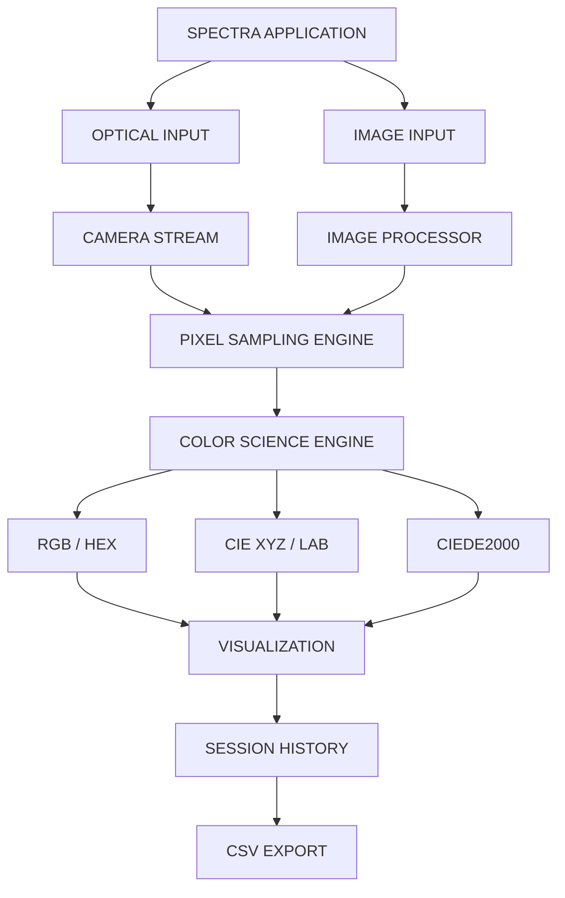

 
<div align="center">


# SPECTRA<span>.</span> METROLOGY

### Advanced Computer Vision · Color Science · Optical Intelligence


<br/>

[](#)
[](#)
[](#)
[](#)

<br/>

**An advanced browser-based optical colorimetry workbench designed for real-time color sampling, scientific color analysis, and precision-oriented visual inspection.**

<br/>

[ Explore Features ](#-core-capabilities) · [ Installation ](#-installation) · [ Architecture ](#-system-architecture)

</div>

---

## ◈ SYSTEM OVERVIEW

SPECTRA is a browser-based industrial color measurement and analysis platform that combines computer vision, mathematical color science, and interactive visualization into a unified workspace.

It transforms a standard camera or uploaded image into a color-analysis environment with detailed chromatic coordinates, color difference calculations, and session-based measurement records.

The interface features a custom **20-Agent Swarm Reconstruction Engine**, creating an animated system initialization experience.

## ◈ CORE CAPABILITIES

<table>
<tr>
<td width="50%">

### 📷 Optical Sensor Engine

- Live camera input
- Static image sampling
- Interactive sampling reticle
- Front/rear camera switching
- Real-time optical preview

</td>
<td width="50%">

### 🎨 Advanced Color Science

- RGB color extraction
- HEX color identification
- CIE XYZ coordinates
- CIE L\*a\*b\* conversion
- HSL color representation
- WCAG contrast calculation

</td>
</tr>
<tr>
<td width="50%">

### 🧬 CIEDE2000 Analysis

- ΔE00 color difference
- Tolerance matrix
- Shade variation analysis
- Chromatic comparison
- Color deviation visualization

</td>
<td width="50%">

### ⚡ Performance Engine

- RequestAnimationFrame processing
- Optimized pixel sampling
- Precomputed sRGB lookup table
- Typed-array pixel buffers
- Dynamic sampling modes
- Live FPS telemetry

</td>
</tr>
<tr>
<td width="50%">

### 📊 Measurement Analytics

- Signal reliability
- Spatial variance
- Specular outlier reporting
- Color coordinate monitoring
- Historical measurement records

</td>
<td width="50%">

### 💾 Session Management

- Save color readings
- Local measurement history
- Persistent browser storage
- HEX and RGB copying
- CSV data export
- Session clearing

</td>
</tr>
</table>

## ◈ THE SWARM REBUILD ENGINE


One of SPECTRA's signature interface experiences is its custom 20-Agent Swarm Reconstruction Engine.

The animation introduces the application through a coordinated interface reconstruction sequence.

**Engine highlights:**

- 20-agent reconstruction sequence
- Animated interface assembly
- Dynamic progress monitoring
- Interactive pause and resume controls
- Completion transition
- Reduced-motion preference support

> A functional interface should be as impressive as the technology operating behind it.

## ◈ COLOR SCIENCE ENGINE

SPECTRA implements mathematical transformations across multiple color spaces.

| Component | Function |
|---|---|
| sRGB | Standard RGB color representation |
| CIE XYZ | Tristimulus color conversion |
| CIE L\*a\*b\* | Perceptual color coordinates |
| CIEDE2000 | Perceptual color difference |
| HSL | Cylindrical color representation |
| WCAG | Contrast ratio calculation |

**Reference standards:**

- CIE 1976 L\*a\*b\*
- CIEDE2000 color difference
- Illuminant D65
- 2° Standard Observer
- ISO/CIE 11664-6
- ASTM D2244

*Note: Implementing these mathematical methods does not itself establish instrument calibration, standards certification, or laboratory-grade measurement accuracy.*

## ◈ SYSTEM ARCHITECTURE



## ◈ TECHNOLOGY STACK

<div align="center">

| Technology | Application |
|---|---|
| HTML5 | Application structure |
| CSS3 | Responsive UI and animations |
| JavaScript ES6+ | Application logic |
| Canvas API | Pixel processing |
| MediaDevices API | Camera access |
| LocalStorage | Measurement persistence |
| SVG | Vector interface graphics |

</div>

## ◈ INSTALLATION

### 01 — Clone Repository

```bash
git clone https://github.com/YOUR-USERNAME/SPECTRA-METROLOGY.git
```

### 02 — Open Project

```bash
cd SPECTRA-METROLOGY
```

### 03 — Launch Application

Using VS Code Live Server, open `index.html`.

Alternatively:

```bash
python -m http.server 8000
```

Visit:

```text
http://localhost:8000
```

**Requirements:**

- Modern browser with JavaScript enabled.
- Camera permission for live optical sampling.
- HTTPS or localhost for camera access.
- No package installation or build process required.

## ◈ PROJECT STRUCTURE

```text
SPECTRA-METROLOGY/
│
├── index.html
│
├── style.css
│
├── script.js
│
└── README.md
```

## ◈ PERFORMANCE & ACCESSIBILITY

SPECTRA incorporates several implementation-level optimizations:

- Precomputed sRGB-to-linear lookup table.
- Typed arrays for pixel sampling buffers.
- Animation-frame-driven processing.
- Responsive desktop and mobile layouts.
- Keyboard-accessible optical viewport.
- Visible keyboard focus indicators.
- Reduced-motion preference handling.
- Graceful local-storage error handling.

## ◈ ROADMAP

- [x] Core color science engine
- [x] Real-time camera integration
- [x] Static image sampling
- [x] CIEDE2000 tolerance matrix
- [x] 20-Agent Swarm Rebuild
- [x] Session measurement history
- [x] CSV export
- [ ] Reference color library
- [ ] Measurement report generation
- [ ] Advanced calibration workflow
- [ ] Multi-session analytics
- [ ] Automated color quality reporting

## ◈ IMPORTANT NOTES

SPECTRA is a client-side color analysis application. Results are influenced by camera sensors, image encoding, exposure, lighting, white balance, and display characteristics.

For laboratory or industrial acceptance testing, use a calibrated reference instrument and a validated measurement procedure.

## ◈ CONTRIBUTIONS

Suggestions, bug reports, and improvements are welcome.

1. Fork this repository.
2. Create a feature branch.
3. Implement your changes.
4. Test the application.
5. Submit a pull request.

## ◈ DEVELOPER

<div align="center">

### BUILT WITH PRECISION. DESIGNED FOR INTELLIGENCE.

**SPECTRA.METROLOGY**

An independent engineering project exploring the intersection of computer vision, color science, and interactive web technologies.

<br/>

[](https://github.com/YOUR-USERNAME/SPECTRA-METROLOGY)

<br/>


**© 2026 SPECTRA.METROLOGY · ENGINEERED FOR PRECISION**

</div>
